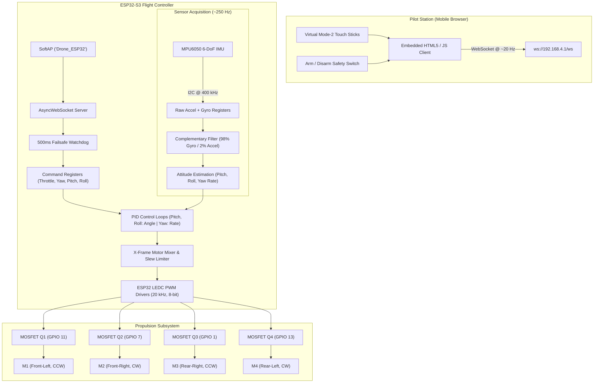

# DIY ESP32-S3 Smartphone-Controlled Micro Quadcopter

[](https://www.espressif.com/en/products/socs/esp32-s3)
[](https://www.arduino.cc/)
[](https://websockets.spec.whatwg.org/)
[](LICENSE)
[](#)

A custom, from-scratch micro quadcopter flight controller and airframe developed on the **ESP32-S3 Super Mini** microcontroller. 

Unlike traditional multirotors that depend on commercial flight controller boards (Betaflight, INAV, Cleanflight) and dedicated RF receivers (ELRS, Crossfire, FrSky), this quadcopter performs onboard sensor reading, real-time sensor fusion, multi-axis PID stabilization, and motor mixing directly on the ESP32-S3. Control is handled wirelessly over Wi-Fi via a zero-install, responsive web application served straight to any smartphone or tablet browser.

---

## Table of Contents
- [System Architecture](#system-architecture)
- [Key Features](#key-features)
- [Airframe Geometry & Motor Configuration](#airframe-geometry--motor-configuration)
- [Hardware & Bill of Materials (BOM)](#hardware--bill-of-materials-bom)
- [Pinout & Wiring Map](#pinout--wiring-map)
- [Circuit & Power Distribution](#circuit--power-distribution)
- [Flight Control & Stabilization Theory](#flight-control--stabilization-theory)
  - [IMU Data Acquisition & Scaling](#1-imu-data-acquisition--scaling)
  - [Sensor Fusion: Complementary Filter](#2-sensor-fusion-complementary-filter)
  - [Multi-Axis PID Controllers](#3-multi-axis-pid-controllers)
  - [X-Frame Motor Mixing](#4-x-frame-motor-mixing)
  - [Transient Protection & Slew-Rate Limiter](#5-transient-protection--slew-rate-limiter)
- [Browser Flight Deck & WebSocket Protocol](#browser-flight-deck--websocket-protocol)
- [Getting Started & Flashing](#getting-started--flashing)
- [Pre-Flight Bench Checklist](#pre-flight-bench-checklist)
- [PID Tuning Guidelines](#pid-tuning-guidelines)
- [Repository Structure](#repository-structure)

---

## System Architecture



---

## Key Features

* **Zero-App Smartphone Interface:** Connect to the drone's Wi-Fi network and open `http://192.168.4.1/`. The responsive Mode-2 dual-stick control surface loads instantly from ESP32 internal flash memory (`PROGMEM`) without internet access or native app installations.
* **Low-Latency Bidirectional WebSocket Link:** Control frames stream at ~20 Hz with sub-10 ms latency over an asynchronous WebSocket connection managed by `ESPAsyncWebServer`.
* **Hardware Arming Safety Interlock:** Motors will refuse to arm if commanded throttle is above zero. The throttle stick rests naturally at 0% at the bottom of its travel, preventing sudden lift-offs or motor surges upon arming.
* **Failsafe Watchdog:** If packet communication drops for longer than 500 ms, all motors instantly cut out to zero power and the flight controller forces an emergency disarm state.
* **Direct Register I2C Processing:** Interrogates the MPU6050 accelerometer and gyroscope registers directly over 400 kHz I2C without third-party library overhead.
* **Attitude Estimation via Complementary Filter:** Combines dynamic angular gyro rates with absolute accelerometer gravity vectors (98% gyroscope / 2% accelerometer) for fast, drift-resistant pitch and roll stabilization.
* **Slew-Rate Ramp Limiting:** Commanded throttle is rate-limited (`THROTTLE_RAMP_RATE = 0.8`), protecting the 1S battery and onboard 3.3V LDO from high $\frac{di}{dt}$ inductive current spikes.
* **Ground-Contact PID Damping:** PID authority is attenuated at near-idle throttle values so motor and chassis vibration on hard surfaces will not cause the differential D-term to kick motors violently.
* **Lightweight Recycled Prototype Frame:** Ultra-lightweight X-chassis folded from thin aluminum sheet stock, yielding an estimated all-up weight (AUW) of ~60–65g.

---

## Airframe Geometry & Motor Configuration

The drone uses a standard **X-quadcopter layout**. Diagonal motor pairs rotate in opposite directions to cancel gyroscopic reaction torque.

```text
               FRONT
                 ▲
                 │
   (M1: CCW)            (M2: CW)
       ▲                    ▲
        \                  /
         \    ┌──────┐    /
          \───│ESP32 │───/
              │  S3  │
          /───│ Super│───\
         /    │ Mini │    \
        /     └──────┘     \
       ▲                    ▲
   (M4: CW)             (M3: CCW)
                 │
               REAR
```

### Motor Assignment Matrix

| Motor | Position | Rotation | Propeller Type | Drive Pin | Yaw Reaction Sign |
|:---:|:---:|:---:|:---:|:---:|:---:|
| **M1** | Front-Left | Counter-Clockwise (CCW) | CCW Prop | **GPIO 11** | `-1` |
| **M2** | Front-Right | Clockwise (CW) | CW Prop | **GPIO 7** | `+1` |
| **M3** | Rear-Right | Counter-Clockwise (CCW) | CCW Prop | **GPIO 1** | `-1` |
| **M4** | Rear-Left | Clockwise (CW) | CW Prop | **GPIO 13** | `+1` |

> **Note on Motor 3 Pin Assignment:** In earlier prototyping revisions, Motor 3 was temporarily mapped to GPIO 2. The production pin map confirms Motor 3 is connected to **GPIO 1** (`M3_PIN 1`).

---

## Hardware & Bill of Materials (BOM)

| Component | Description / Specification | Qty | Function |
|---|---|:---:|---|
| **Flight Controller** | ESP32-S3 Super Mini (Dual-Core Xtensa LX7, 240MHz, 2.4GHz Wi-Fi) | 1 | Sensor reading, flight PID loop, SoftAP web server |
| **IMU Sensor** | MPU6050 6-DoF Accelerometer + Gyroscope Module | 1 | Attitude & rate sensing over I2C |
| **Motors** | 8520 Coreless Brushed DC Motors (3.7V, ~50,000 RPM) | 4 | 2x CW rotation, 2x CCW rotation |
| **Propellers** | 55 mm Propeller Blades (0.9 mm shaft bore) | 4 | 2x CW blades, 2x CCW blades |
| **Power Source** | 1S 3.7V 600 mAh LiPo Battery (Model 602030, JST-PH 2.0) | 1 | Main propulsion and system power |
| **Switching MOSFETs** | SI2302 N-Channel Logic-Level MOSFETs (SOT-23, $V_{DS}=20\text{V}$, $I_D=2.8\text{A}$) | 4 | Low-side motor switches driven directly by 3.3V logic |
| **Gate Resistors** | 220 Ω 0805 / 0603 SMD or Axial | 4 | Gate current dampening & oscillation suppression |
| **Pulldown Resistors** | 10 kΩ SMD or Axial | 4 | Pulls MOSFET gates to GND during MCU boot/reset |
| **Flyback Diodes** | 1N5819 or SS14 Schottky Diodes (Cathode to Battery+) | 4 | Protects MOSFETs from inductive back-EMF spikes |
| **Motor Snubbers** | 100 nF Ceramic Capacitors (0.1 µF across motor terminals) | 4 | Suppresses high-frequency brush arcing noise |
| **Bulk Capacitor** | 470 µF 16V Low-ESR Electrolytic Capacitor | 1 | Buffers transient current dips across the LiPo rail |
| **Frame** | Custom Fusion 360 Folded Aluminum Sheet X-Frame | 1 | Rigid structural airframe (~60–65g target AUW) |

---

## Pinout & Wiring Map

```text
                       ESP32-S3 Super Mini
                         ┌─────────────┐
                         │   [USB-C]   │
                         │             │
        (Motor 3 Gate) ──┤ GPIO 1  5V  ├── (Direct to Battery+ / 5V In)
                         │ GPIO 2  GND ├── (Common System Ground Rail)
                         │ GPIO 3  3V3 ├── (Power to MPU6050 VCC)
    (Battery ADC, Res.) ─┤ GPIO 4  IO10├──
                         │ GPIO 5  IO9 ├── (MPU6050 SDA)
                         │ GPIO 6  IO8 ├── (MPU6050 SCL)
        (Motor 2 Gate) ──┤ GPIO 7  IO11├── (Motor 1 Gate)
                         │ GPIO 12 IO13├── (Motor 4 Gate)
                         └─────────────┘
                               B+   B-
                               │    │
                               │    └───── [Battery Negative / GND]
                               └────────── [Battery Positive +3.7V]
```

### Complete Pin Allocation

| ESP32-S3 Pin | Connected Device | Peripheral Pin | Direction / Logic Level | Notes |
|:---:|:---:|:---:|:---:|---|
| **GPIO 9** | MPU6050 | SDA | Bidirectional (3.3V) | I2C Data bus (pullup on sensor module) |
| **GPIO 8** | MPU6050 | SCL | Output (3.3V) | I2C Clock bus (400 kHz Fast Mode) |
| **GPIO 11** | Motor Driver 1 | Gate M1 | Output (PWM 20 kHz) | Front-Left Motor (CCW) |
| **GPIO 7** | Motor Driver 2 | Gate M2 | Output (PWM 20 kHz) | Front-Right Motor (CW) |
| **GPIO 1** | Motor Driver 3 | Gate M3 | Output (PWM 20 kHz) | Rear-Right Motor (CCW) |
| **GPIO 13** | Motor Driver 4 | Gate M4 | Output (PWM 20 kHz) | Rear-Left Motor (CW) |
| **GPIO 4** | Voltage Divider | Battery Sense | Analog Input (ADC) | Reserved for future low-voltage telemetry |
| **B+ Pad** | 1S LiPo (+) Rail | Positive | Power Input | Direct LiPo power input; charges via USB-C |
| **B- Pad** | 1S LiPo (-) Rail | Negative | Ground Reference | Common ground with system GND |

---

## Circuit & Power Distribution

### Low-Side MOSFET Motor Driver (×4 Channels)

Each motor channel utilizes a logic-level N-channel MOSFET configured as a low-side switch:

```text
                  +3.7V Battery Rail (Direct from LiPo)
                            │
                            ├────────────────────────┐
                            │                        │
                         ┌──┴──┐                     │
                         │  +  │                  ┌──┴──┐
                         │     │ Motor            │  ▲  │ Flyback Diode
                         │ 8520│ (With 100nF cap  │ --- │ (1N5819 / SS14)
                         │     │ across terminals)│  │  │ (Cathode to Batt+)
                         │  -  │                  └──┬──┘
                         └──┬──┘                     │
                            │                        │
                            ├────────────────────────┘
                            │
                         ┌──┴──┐ Drain
                         │  D  │
    ESP32 GPIO ──[220Ω]──┤G   S│ SI2302 N-MOSFET
                         │  S  │
                         └──┬──┘ Source
                            │
                            ├────────────────────────┐
                            │                        │
                         ┌──┴──┐                     │
                         │ 10k │ Pulldown            ▼
                         │     │                  Common
                         └──┬──┘                  Ground
                            │
                            ▼
                         Common
                         Ground
```

### Power Bus Best Practices

> [!IMPORTANT]
> **Motor Current Path Separation:** Motor positive wires must connect directly to the LiPo battery rail, **never through the internal power traces of the ESP32 board**. 
>
> 4 coreless motors under full acceleration can pull between **4A and 6A** aggregate. Route high-current motor power directly to the battery and solder the **470 µF capacitor** directly across the main battery power input pads (`B+` and `B-` / GND) to prevent brownout dips.

---

## Flight Control & Stabilization Theory

### 1. IMU Data Acquisition & Scaling
The firmware polls the MPU6050 at ~250 Hz (`4 ms` cycle target). Accelerometer registers are read with a full-scale range of $\pm 2\text{g}$ ($16,384 \text{ LSB/g}$), and the gyroscope operates at $\pm 250^\circ/\text{s}$ ($131.0 \text{ LSB}/(^\circ/\text{s})$).

### 2. Sensor Fusion: Complementary Filter
Accelerometers provide reliable long-term gravitational vectors but suffer from high-frequency vibration noise during motor operation. Gyroscopes offer high-speed angular rate tracking with zero susceptibility to linear acceleration, but integrate low-frequency drift over time. 

A high-pass/low-pass **Complementary Filter** fuses both data sources:

$$\theta_{\text{pitch}} = 0.98 \cdot \left(\theta_{\text{pitch}} + \omega_y \cdot \Delta t\right) + 0.02 \cdot \arctan\left(\frac{-a_x}{\sqrt{a_y^2 + a_z^2}}\right)$$

$$\phi_{\text{roll}} = 0.98 \cdot \left(\phi_{\text{roll}} + \omega_x \cdot \Delta t\right) + 0.02 \cdot \arctan\left(\frac{a_y}{a_z}\right)$$

Yaw heading is integrated dynamically using direct Z-axis angular rate ($\omega_z$), running in **Rate Mode**.

### 3. Multi-Axis PID Controllers
Error signals are computed between setpoints commanded by the smartphone joysticks and measured attitudes:

$$u(t) = K_p \cdot e(t) + K_i \int_0^t e(\tau)d\tau + K_d \cdot \frac{e(t) - e(t - \Delta t)}{\Delta t}$$

* **Pitch & Roll (Angle / Self-Level Mode):** Joystick tilt requests a target angle ($\pm 30^\circ$). The PID controller commands differential thrust to return the airframe to horizontal when sticks are released.
* **Yaw (Rate Mode):** Joystick deflection requests an angular rotation speed in degrees per second.
* **Anti-Windup Protection:** Integral error is constrained within $[-100, 100]$ to prevent integrator windup during saturated or ground conditions.

### 4. X-Frame Motor Mixing
The outputs of the three PID loops ($P_{\text{out}}, R_{\text{out}}, Y_{\text{out}}$) are combined with base throttle ($T_{\text{base}}$) into per-motor 8-bit duty cycle values ($0 - 255$):

$$\begin{aligned}
M_1 \, (\text{Front-Left})  &= T_{\text{base}} - P_{\text{out}} + R_{\text{out}} - Y_{\text{out}} \\
M_2 \, (\text{Front-Right}) &= T_{\text{base}} - P_{\text{out}} - R_{\text{out}} + Y_{\text{out}} \\
M_3 \, (\text{Rear-Right})  &= T_{\text{base}} + P_{\text{out}} - R_{\text{out}} - Y_{\text{out}} \\
M_4 \, (\text{Rear-Left})   &= T_{\text{base}} + P_{\text{out}} + R_{\text{out}} + Y_{\text{out}}
\end{aligned}$$

### 5. Transient Protection & Slew-Rate Limiter
To eliminate current inrush brownouts, commanded throttle is governed by a software slew limiter:

```cpp
if (currentThrottle < targetThrottle) {
  currentThrottle = min(currentThrottle + THROTTLE_RAMP_RATE, targetThrottle);
} else {
  currentThrottle = max(currentThrottle - (THROTTLE_RAMP_RATE * 2.0f), targetThrottle);
}
```

* **Smooth Ramp-Up (`0.8` step/cycle):** Prevents instant multi-amp battery sags when the throttle stick is moved aggressively.
* **Rapid Ramp-Down (`1.6` step/cycle):** Ensures immediate motor deceleration when the pilot cuts throttle or disarms.
* **Low-Throttle Damping:** When $T_{\text{base}} < 40$, PID output authority scales proportionally down to $0$, preventing high-frequency bench vibration resonance before takeoff.

---

## Browser Flight Deck & WebSocket Protocol

### Network Settings
* **Wi-Fi Mode:** SoftAP (Microcontroller broadcasts its own autonomous WLAN)
* **SSID:** `Drone_ESP32`
* **Password:** `drone1234`
* **Default IP Address:** `192.168.4.1`
* **Port:** HTTP `80`, WebSocket `/ws`

### Web Interface Features
1. **Mode 2 Virtual Joysticks:**
   * **Left Stick:** Vertical axis controls Throttle ($0 - 255$). Horizontal axis controls Yaw rate ($-100$ to $+100$). Throttle rests at $0$ at the bottom and auto-returns to zero upon touch release for safety.
   * **Right Stick:** Controls Pitch (vertical, $-100$ to $+100$) and Roll (horizontal, $-100$ to $+100$). Auto-centers to zero on release.
2. **Arm / Disarm Interlock Button:**
   * Tapping **ARM** activates the motor outputs.
   * Arming is rejected if throttle is raised above idle, displaying `SAFETY: LOWER THROTTLE TO 0 BEFORE ARMING!`.
3. **Live Telemetry Bar:** Displays real-time throttle percentage, raw duty values, and connection health status.

### WebSocket Data Packet Format
The browser client transmits a compact CSV frame every 50 ms (~20 Hz):

```text
<ARMED>,<THROTTLE>,<YAW>,<PITCH>,<ROLL>
```

**Example:**
* `0,0,0,0,0` — Disarmed state, all controls neutral.
* `1,120,0,15,-10` — Armed, ~47% throttle, straight heading, slight forward pitch and left bank.

---

## Getting Started & Flashing

### 1. Software Prerequisites
* [Arduino IDE](https://www.arduino.cc/en/software) (Version 2.x recommended)
* **ESP32 Board Package:** Install `esp32` by Espressif via Arduino Boards Manager (Version 2.0.14 or 3.x).
* **Required Libraries:**
  * `ESPAsyncWebServer` (Install fork by lacamera / ESP32Async)
  * `AsyncTCP` (Install fork by dvarrel or me-no-dev)
  * `Wire` (Built-in Arduino I2C)
  * `WiFi` (Built-in Arduino ESP32 Wi-Fi)

### 2. Arduino IDE Board Configuration
In the **Tools** menu, configure your board settings as follows:
* **Board:** `ESP32S3 Dev Module` (or your specific `ESP32-S3 Super Mini` board definition)
* **USB CDC On Boot:** `Enabled`
* **CPU Frequency:** `240MHz (WiFi)`
* **Flash Mode:** `QIO 80MHz`
* **Flash Size:** `4MB (32Mb)`
* **Partition Scheme:** `Huge APP (3MB No OTA/1MB SPIFFS)` or `Default 4MB with spiffs`
* **Upload Speed:** `921600` (or `115200` if upload fails)

### 3. Flashing Procedure
1. Open [`drone_firmware/drone_firmware.ino`](file:///c:/Users/91906/OneDrive/Documents/Self%20Projects/ESP32%20S3%20Drone/drone_firmware/drone_firmware.ino).
2. Connect the ESP32-S3 Super Mini to your computer via a data-capable USB-C cable.
3. If the board does not auto-enter flash mode, hold the **BOOT** button, tap the **RESET** button once, then release **BOOT**.
4. Select the matching COM port and click **Upload**.

---

## Pre-Flight Bench Checklist

> [!CAUTION]
> **ALWAYS PERFORM BENCH TESTS WITH PROPELLERS REMOVED.**
> Coreless motors spinning at 50,000 RPM can cause injury or damage wiring if uncontrolled oscillations occur.

- [ ] **Physical Wire Inspection:** Ensure all motor leads, battery terminals, and MOSFET gate resistors are insulated with electrical tape or Kapton tape from the conductive aluminum frame.
- [ ] **Diode Orientation Check:** Verify that the silver cathode band on every flyback diode points directly toward the **Battery+** rail.
- [ ] **USB Boot & Wi-Fi Check:**
  1. Power the ESP32 via USB with battery disconnected.
  2. Search for `Drone_ESP32` in your smartphone Wi-Fi settings.
  3. Connect using password `drone1234` and open `http://192.168.4.1`.
  4. Verify the joystick HUD appears with `Throttle: 0%` and `State: DISARMED`.
- [ ] **Motor Direction Verification (Props Off):**
  1. Connect the 1S LiPo battery.
  2. Tap **ARM** on the web page.
  3. Gently raise throttle to 10%–15%.
  4. Check shaft spin directions:
     - M1 (Front-Left): **Counter-Clockwise**
     - M2 (Front-Right): **Clockwise**
     - M3 (Rear-Right): **Counter-Clockwise**
     - M4 (Rear-Left): **Clockwise**
- [ ] **Attitude Response Direction:**
  1. Hold the drone firmly in hand (props off) at ~25% throttle.
  2. Tilt the front down: Front motors (M1, M2) should speed up to resist the tilt.
  3. Tilt to the left: Left motors (M1, M4) should speed up.

---

## PID Tuning Guidelines

Default PID gains in [`drone_firmware.ino`](file:///c:/Users/91906/OneDrive/Documents/Self%20Projects/ESP32%20S3%20Drone/drone_firmware/drone_firmware.ino) are initial baselines:

```cpp
PID pitchPID = {2.0, 0.02, 0.8};
PID rollPID  = {2.0, 0.02, 0.8};
PID yawPID   = {1.5, 0.0,  0.0};
```

When transitioning to tethered hover tests:
1. **$K_p$ (Proportional):** Increase gradually until the drone feels responsive. If the drone wobbles rapidly at a high frequency, reduce $K_p$.
2. **$K_d$ (Derivative):** Increase to dampen overshoots and smooth out fast wobbles. Excessive $K_d$ will amplify brushed motor noise and make motors run warm.
3. **$K_i$ (Integral):** Keep low initially. Increase incrementally if the quadcopter sags or fails to hold angle trim over several seconds.

---

## Repository Structure

```text
ESP32 S3 Drone/
├── README.md                     # Comprehensive project documentation
├── DEBUG_LOG.md                  # Detailed hardware diagnostic logs & bench notes
└── drone_firmware/
    └── drone_firmware.ino        # Full Arduino C++ flight controller sketch
```

---

## License & Attribution

This project is open-source under the [MIT License](LICENSE). Built for educational exploration in embedded C++, control theory, and scratch-built robotics.
